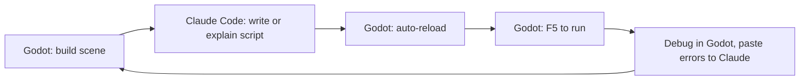
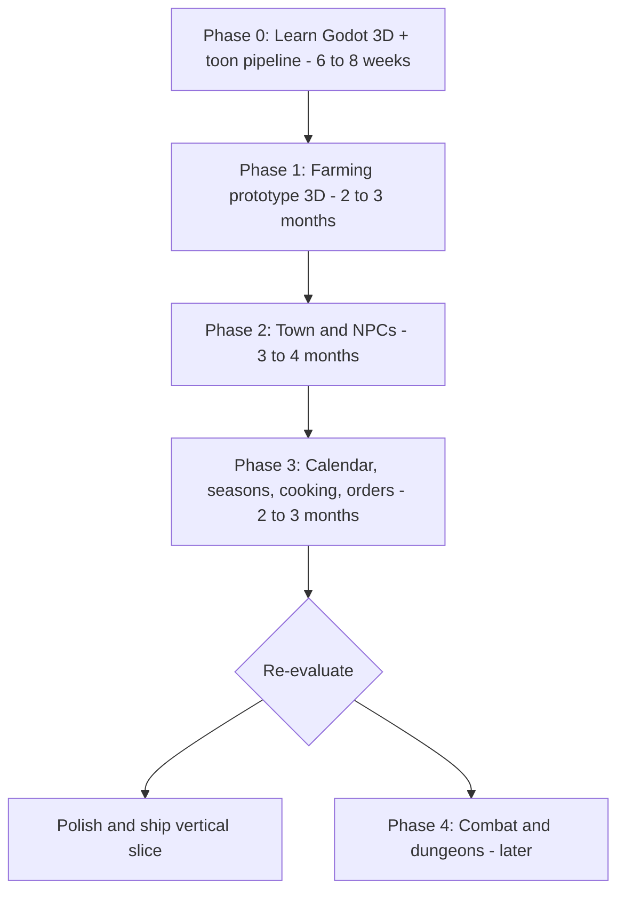
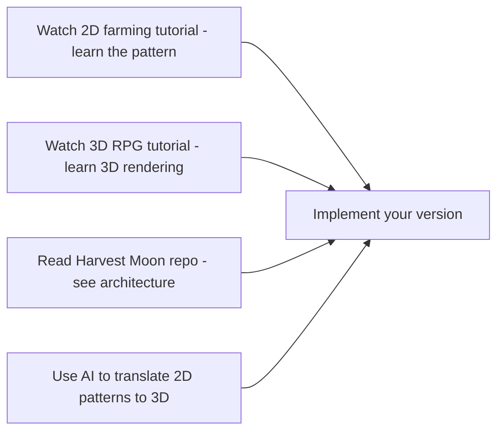

# Greenrune — Starter Roadmap (Chibi 3D edition)

*A Rune Factory-inspired farming and town life-sim. Working title: **Greenrune**. Repo folder: `runefactory-clone` (placeholder, may rename to `greenrune` later).*

## Visual target

Chibi low-poly 3D characters with toon/cel shading in a stylized 3D world, viewed from a fixed semi-top-down camera. Dialogue uses 2D anime-style portraits over the 3D world. **Target reference: RF4 / RF3 Special** — both render simple 3D worlds (flat ground, low-poly buildings, placed props) with chibi toon-shaded characters. The expensive-looking part of that aesthetic comes free from KayKit + Mixamo; the world is intentionally simple.

**Hard commitment: asset packs only.** No custom humanoid modeling, no custom building modeling, until Phase 4+ at earliest. KayKit Adventurers + KayKit Dungeon + Quaternius Ultimate Nature + Mixamo + a single toon shader is the entire art toolkit for Phases 0–3.

## Ground rules (read these first)

1. **You are learning Godot AND Blender AND building a game at the same time.** That's three skill curves at once. Multiply your time estimates by ~2x; this is normal for a first 3D hobby project.
2. **Combat, monsters, dungeons, marriage, magic — all deferred.** Not "skipped forever," just not now. The moment you let these creep in early, the project dies. RP and use-based skills are *not* combat systems: in RF4 they are the farming energy bar and progression first, so they start in Phase 1.
3. **Assets first, custom modeling later (if ever).** You will use **KayKit**, **Quaternius**, **Mixamo**, and **Kenney 3D** for the entire first year. Only model things in Blender that you can't find in a free pack. Even commercial indies do this.
4. **AI assists, you understand.** Never paste code you can't explain in plain English. AI is great at GDScript boilerplate, shaders, and state machines, but it will confidently invent Godot APIs that don't exist. Verify against the [Godot 4 docs](https://docs.godotengine.org/en/stable/).
5. **Done > perfect.** Every phase ends in a playable build you'd send to a friend, even if it's ugly.

## Design pillars (from RF4 research)

What makes RF4 work, per [rf4-research.md](rf4-research.md). Check every feature against these.

1. **Every action feels good and levels something.** Tool swings "pop", and each one spends RP and earns skill XP.
2. **Systems intersect.** Each activity's output is another activity's input (crops → dishes → gifts and festival entries; later, dungeon drops → gear → deeper dungeons).
3. **A small microcosm.** Every NPC is named and reacts to time, season, weather and events.
4. **The player chooses the day.** No forced path; the story (if any) can be ignored.
5. **Teach fast.** RF4's ~10-hour tutorial is its most-cited flaw. Unlock systems through play (requests, orders), not long guided sequences.

**Scale reality check:** Stardew Valley took one person 4.5 years at reported 10–12-hour days. RF4's own director and writer estimate 10–20 years for their two-person RF-like without funding. Copy RF4's *structure*, not its scale; the cost is content and writing, not code.

## Engine & tooling decision

- **Engine: Godot 4 (latest stable)** — free, MIT license, 3D got dramatically better in v4, GDScript is Python-like and very AI-friendly.
- **3D modeling/animation: Blender (latest LTS)** — free, industry-standard. Used minimally; mostly for editing existing assets and small props.
- **Asset pipeline: GLTF/GLB** — the modern standard, fully supported by both Blender and Godot.
- **Auto-rigging/animation: [Mixamo](https://www.mixamo.com)** — free from Adobe. Upload a model, get walk/idle/attack/sit animations. Eliminates ~80% of beginner animation pain.
- **Language: GDScript** (not C#). Lower friction for a first game, more tutorials, AI handles it well. (You can switch to C# in Godot later if AI assistance on GDScript ever frustrates you — C# has more training data.)
- **Version control: Git from day one** with [Git LFS](https://git-lfs.com/) for `.blend`, `.glb`, and texture files (binary assets bloat normal Git fast).
- **AI assistant: Claude Code**, run in the project folder. Project rules live in [CLAUDE.md](../CLAUDE.md) and [.claude/rules/](../.claude/rules/). Godot's built-in editor handles scenes, scripts, running, and debugging. See the [Claude Code + Godot workflow](#claude-code--godot-workflow) section below.

## Claude Code + Godot workflow

You'll run **Godot and Claude Code side-by-side** on the same project folder. Godot is for scenes, levels, running and debugging. Claude Code is for writing and explaining GDScript, reviewing code, and design questions.

### One-time setup (Phase 0, week 1)

1. **In Godot**: `Editor → Editor Settings → Text Editor → Behavior → Files` → enable **Auto Reload Scripts on External Change**, so scripts Claude edits reload without a prompt.
2. **In the project root**: [CLAUDE.md](../CLAUDE.md) holds the project rules (Godot 4 APIs, code style, the 2D/3D convention, scope). [.claude/rules/godot-performance.md](../.claude/rules/godot-performance.md) loads whenever Claude touches a `.gd` file. Keep both up to date as conventions settle; this is the single most important AI-quality investment you'll make.
3. **Open Claude Code in the project folder** (terminal or desktop app) while Godot is open.

### Daily workflow



- **Use Claude Code for**: writing and editing `.gd` scripts, explaining Godot concepts, debugging from error output, multi-file refactors, shaders, design discussions.
- **Use Godot for**: scene tree, inspector tweaks, F5/F6 to run, visual debugger, profiler, animation editor, particle editor, GLTF import config.
- **Scene files:** build and edit `.tscn` scenes in Godot. If Claude needs to change a scene file, save and close that scene in Godot first, or Godot may overwrite the change.

### Known AI hallucination patterns in Godot (watch for these)

- AI writing **Godot 3 syntax** (older API) — CLAUDE.md pins Godot 4, but still check.
- Inventing methods that sound plausible but don't exist (e.g. `get_node_or_null` is real, `get_child_by_name` is not).
- Confusing `_process` and `_physics_process` semantics — `_physics_process` for physics/movement, `_process` for everything else.
- Suggesting `KinematicBody` (Godot 3) instead of `CharacterBody2D/3D` (Godot 4).
- Wrong signal connection syntax (Godot 4 uses `signal_name.connect(callable)`, not the old `connect("signal_name", target, "method")`).

The fix: a strong CLAUDE.md + always cross-checking unfamiliar APIs against [docs.godotengine.org](https://docs.godotengine.org/en/stable/). AI is a co-pilot, not autopilot, especially for newer engines like Godot 4.

## Art strategy — free pre-rigged 3D asset packs

**You are NOT modeling humans from scratch.** Beginner-rigged humanoids fail in ways that look amateur. Use these instead:

- **[KayKit](https://kaylousberg.com/game-assets)** — free chibi RPG character + dungeon packs, already rigged, GLB format. **This is your primary character source.**
- **[Quaternius](https://quaternius.com/)** — huge free low-poly library: nature, farm, animals, buildings, props. CC0 license.
- **[Mixamo](https://www.mixamo.com)** — free auto-rigging + thousands of animations. Combine with KayKit characters for walk/idle/attack/sit/etc.
- **[Kenney 3D](https://kenney.nl/assets?q=3d)** — same trusted Kenney quality, 3D variants. CC0.
- **[Synty POLYGON packs](https://syntystore.com/)** ($15–40, optional later) — production-grade. Used by many shipped indies if you want to invest later.

**Style cohesion rule:** Pick ONE primary character pack (KayKit) and ONE primary environment pack (Quaternius or KayKit Dungeon) and stick to them. Mixing chibi proportions with realistic proportions is the #1 visual sin and instantly looks amateur.

**Toon shader:** You'll need a cel-shading shader for the RF-style look. Options:

- Use a community shader from [Godot Shaders](https://godotshaders.com/) (search "toon" or "cel")
- Have AI help you write a simple one (GLSL/Godot Shader Language)
- Outline effect via inverted hull or post-processing shader

Budget ~1 weekend in Phase 0 to get a toon shader you're happy with running on a test sphere + character.

### Hybrid 2D/3D — design convention

**Project convention (locked in):** the world is 3D; *abstractions* of things are 2D.

| Thing | Representation | Why |
|---|---|---|
| Anything that occupies space in the world (terrain, buildings, trees, NPCs, the player, growing crops in a tile) | **3D model** (toon-shaded) | It's a physical object in a 3D world. |
| Inventory icons, hotbar, shop UI, tooltips, recipes, quest items | **2D `Texture2D` in `Control` nodes** | It's a UI abstraction of an item, not the item itself. Reads better at small sizes, stack counts overlay naturally, ~free to render. |
| Dropped/floating item on the ground (pre-pickup) | **2D billboard `Sprite3D`** (always faces camera) | RF4-style "JRPG charm," reuses the same icon asset as the inventory, no extra 3D model needed per item. |
| FX, popups ("+1 Turnip"), sparkles, dust, distant filler grass | **2D billboard `Sprite3D` or sprite-textured `GPUParticles3D`** | Cheap, expressive, on-aesthetic. |

**The unification trick:** one icon asset (e.g. `turnip_icon.png`) is the single source of truth — it shows up as the inventory icon, the hotbar icon, *and* the dropped-on-ground billboard. No style drift, no doubled art workload.

**Optional later:** if you ever want inventory icons that match 3D models more literally (Minecraft-style), render the 3D model once via a `SubViewport` in Godot (or in Blender) to a `Texture2D` and use that as the icon. Keeps the workflow 3D-first but UI still cheap. Don't do this in Phase 1 — paint icons directly.

### Hybrid 2D/3D — Sprite3D for props and effects

**Look closely at RF4 and you'll notice many "3D" elements are actually 2D sprites billboarded in 3D space.** Crop growth stages, pickup pop-ups ("+1 Turnip"), sparkle particles, distant grass, some held tools at rest — all flat 2D sprites that always face the camera. This is a deliberate hybrid technique, not a limitation.

**Godot supports this natively with `Sprite3D`:**

- Loads a 2D image (PNG/JPG)
- Lives in 3D space, depth-sorted against 3D objects correctly
- Set `Billboard` property to `Enabled` and it always faces the camera
- ~100x cheaper than even a low-poly 3D mesh
- Reuses the same image asset for both the world view and the inventory icon

**When to use `Sprite3D` over a 3D model** (for things actually in the 3D world — inventory/UI is always plain 2D `Texture2D`, see convention table above):

| Use case | Sprite3D | 3D model |
|---|---|---|
| Dropped item on ground (pre-pickup) | **Yes — recommended** | Overkill |
| Pickup pop-up effects ("+1") | Yes | Overkill |
| Crop growth stages | No | **Yes — chosen**: low-poly, toon-shaded, one model file per stage, like Farnia Village |
| Small ground plants, flowers, mushrooms | Yes | Overkill |
| Particles (dust, sparkles, leaves) | Yes (or `GPUParticles3D` with sprite texture) | — |
| Trees | No | Yes (trees benefit from depth) |
| Buildings, fences, terrain props | No | Yes |
| Player + NPCs | No | Yes (animation matters) |
| Held tools (in active use) | Maybe | Maybe — both work |

**Crops are the exception to RF4:** growth stages are low-poly 3D models (like Farnia Village), not billboards. The Quaternius LowPoly Crops Pack supplies them, so there's no Blender time, and they share the cel shader with the rest of the world.

**Style cohesion warning:** if you go hybrid, pick a consistent pixel-art or painted-sprite style and stick to it. Mixing photoreal sprite textures with toon-shaded 3D will look bad. Sprout Lands-style chunky pixel art reads well next to KayKit chibi 3D — they share visual "weight."

## Phased roadmap

Timelines below assume ~8 hrs/week **and** the asset-packs-only commitment from the Visual target section. Custom Blender modeling would add 30–50% to these numbers; the plan is designed to avoid that.



For everything after the slice (Phases 4–10, milestones, scope targets for 1.0), see [endgame.md](endgame.md).

**Total to playable vertical slice: ~12–15 months** (asset-packs-only). If you start custom-modeling humanoids or buildings, expect 16–20+ months instead.

### Phase 0 — Learn Godot 3D + toon pipeline (6–8 weeks, ~8 hrs/week)

Do tutorials end-to-end without skipping. Do NOT start the real project yet. The week-by-week list is [PHASE_0_CHECKLIST.md](../PHASE_0_CHECKLIST.md).

**Godot 3D fundamentals (~4–5 weeks):**

- Official Godot "Your First 3D Game" tutorial (~3 hours).
- A 3D action RPG tutorial series — see [Tutorials & resources](#tutorials--resources) section for current recommendations.
- **Exit criterion:** you can explain `Node3D`, `CharacterBody3D`, `MeshInstance3D`, GLTF import, raycasts, and the basics of a `NavigationAgent3D`.

**Asset pipeline (~1 week):** import KayKit GLB characters and Mixamo animations with the Antz workflow. No Blender needed.

**Toon shader (~1 weekend):**

- Find a community cel/toon shader on Godot Shaders, drop it onto a test scene, get it looking how you want.
- Bonus: outline shader (inverted hull method is easiest).
- **Exit criterion:** A KayKit chibi character standing on a Quaternius grass patch, both rendered with your toon shader, with a basic outline. Save this scene; it becomes your visual baseline.

**Feel test (~1 weekend):** a throwaway scene where one hoe swing hits a tile with sound, particles and a tiny camera shake. It checks the riskiest assumption in the plan (that tool use can feel good in Godot 3D) before Phase 1 builds on it.

**Blender is not in Phase 0.** The asset-packs-only commitment means you won't model anything until Phase 4+. Learn the Blender → Godot export roundtrip the first time you actually need a custom prop (see [Blender for game devs](#blender-for-game-devs-when-you-first-need-a-custom-prop)).

### Phase 1 prerequisites — Godot MCP setup (do at the START of Phase 1)

Before writing real game code in Phase 1, set up Godot's MCP server so Claude Code can launch the editor, run the project, read debug output, and create scenes and nodes in your actual project. **This was deliberately deferred from Phase 0** — during tutorials you want to learn manually; during real development you want AI to see your codebase.

**Recommended servers (pick one):**

- **[Coding-Solo/godot-mcp](https://github.com/coding-solo/godot-mcp)** — most popular (2,785+ stars), MIT, easiest setup. **Start here.**
- **[tugcantopaloglu/godot-mcp](https://github.com/tugcantopaloglu/godot-mcp)** — 149 tools, most feature-rich. Switch to this if you outgrow the first.
- **[lifeiscontent/godot-mcp](https://github.com/lifeiscontent/godot-mcp)** — native GDScript addon, no Node.js dependency. Good if you don't want extra runtimes.

**Setup for Coding-Solo's server (the simple path):**

Needs Node.js 18+. From the project folder:

```bash
claude mcp add godot -e GODOT_PATH=/Applications/Godot.app/Contents/MacOS/Godot -- npx @coding-solo/godot-mcp
```

Restart Claude Code. The Godot MCP tools should appear in your available tools. (`GODOT_PATH` is optional if the server finds Godot on its own.)

**What this gives you** ([tool list](https://github.com/Coding-Solo/godot-mcp)):

- AI can launch the editor, run and stop the project
- AI can read debug output and runtime errors
- AI can create scenes, add nodes and save scenes
- AI can read project info and the Godot version

**When NOT to use MCP:**

- During the Godot Docs and GDQuest tutorials — you want manual practice.
- For trivial single-script changes — editing the script directly is enough.

**Risk to watch:** with MCP, AI can do too much for you. If you find yourself asking AI to "build the inventory scene for me" instead of "explain how I should structure the inventory scene," step back. MCP makes the lazy path easier — discipline yourself to use it for *augmentation*, not replacement.

### Phase 1 — Farming prototype, 3D (3–4 months)

Smallest possible playable loop. **One 3D farm scene, no town yet.**

- **Player character:** KayKit Adventurer chibi model + Mixamo walk/idle animations.
- **Camera:** fixed semi-top-down (~45° angle, follows player), similar to RF4. Implement as a `Camera3D` attached to a `SpringArm3D`.
- **Farm scene:** terrain (small flat MeshInstance or HeightMap), Quaternius/KayKit barn + fences + trees as props.
- **Tools:** hoe (till — modifies a tile state), watering can, sickle, seeds, harvest. Tile state is a 2D grid managed in code, but visuals are 3D.
- **Tools are combat-shaped:** every tool use is a swing with a hitbox, an RP cost and skill XP. Phase 4 weapons then become more items on the same pipeline (RF4 already lets weapons do farm work) instead of a bolt-on rewrite.
- **RP bar:** one Rune Points bar that every tool action spends. Empty RP drains HP instead. Refill by sleeping (and later food). This gives the day its budget.
- **Skills that level by use:** 4–6 to start, tied to Phase 1 actions (e.g. tilling, watering, reaping, walking, sleeping). Each level lowers that skill's RP cost and raises max RP. RF4 has 38; don't go near that.
- **Crops:** 2 types (e.g. turnip fast, potato slow), each with 3 growth stages. Each stage is a low-poly 3D model from the Quaternius LowPoly Crops Pack, toon-shaded, one model file per stage — see "Hybrid 2D/3D" above.
- **Crop and seed levels (1–10):** harvests carry a level; reaping a grown crop with the sickle returns seeds, sometimes a level higher. This is RF4's long-term farm goal with no extra content.
- **Data-driven items:** one Godot `Resource` per item definition (or a CSV) from day one. Hard-coded items are the classic RF-clone killer.
- **Inventory + hotbar:** 2D UI (`Control` nodes) overlaid on the 3D world. Start with 8 slots. Each stack is an item *instance* (item id + level), not a bare count.
- **Day cycle:** sleep-to-next-day. Use a `DirectionalLight3D` rotating around to fake sun position. Skybox can be a simple gradient. Crops grow and soil dries at the 06:00 wake-up tick; build one ordered end-of-day pipeline now, since crops, NPCs, requests and monsters will all hook into it.
- **Save/load:** implement in week 2–3, NOT later. Refactoring saves into a finished project is hell. Save tile states, inventory (item id + level per stack), RP, skill XP, time, gold.
- **Shipping bin:** like RF4, a container you fill and empty freely; everything in it sells at 08:00, priced by item level. RF4 shops buy nothing, so there is no "sell all" shop NPC (see the [RF4 research](rf4-research.md#shipping-and-selling-researched)).

**Exit criterion:** play 5 in-game days, save, quit, reload, continue farming. RP runs out by evening, at least one skill levels up, and a reaped seed comes back a level higher. It's ugly and minimal but the 3D loop works.

### Phase 2 — Town & NPCs (4–5 months)

Now add the social layer in 3D.

- **Town scene:** second 3D scene built from Quaternius/KayKit buildings. Seamless transition from farm (probably scene-switch with fade rather than streaming for simplicity).
- **3–5 NPCs:** each = a KayKit model with a different texture/color + Mixamo animations. Every NPC is named; no nameless shop clerks. Daily state-machine schedules (home → work → tavern → sleep).
- **Pathfinding:** Godot's `NavigationAgent3D` + baked navmesh on the town scene.
- **Dialogue:** [Dialogic 2](https://github.com/dialogic-godot/dialogic) plugin. Use 2D portrait art for dialogue boxes — for placeholder portraits, you can commission cheap art on Fiverr later, or use AI-generated placeholders (single static images are fine; AI is bad at animated frames but okay at single portraits).
- **Line selection layer:** Dialogic 2 handles display and branching, not *which* line to say. Build a small "pick the best-matching line" layer keyed on time, season, weather, friendship and recent events. RF4's writer: if routines change but lines don't, "the village will feel lifeless."
- **Friendship/affection points** per NPC: daily talk, one counted gift per day, birthdays double the gift value.
- **Gift system** with per-NPC likes/dislikes/hates. Crop level should affect gift value.
- **Proper shop:** buy seeds. Like RF4, shops don't buy; selling stays with the shipping bin until your own store in a later phase.

**Budget warning:** this phase is content-bound, not code-bound. Most of the 4–5 months is writing lines, not building systems.

**Exit criterion:** max friendship with one NPC over ~14 in-game days through dialogue and gifts, and that NPC says different things in the morning than in the evening. Watching a chibi character walk a navmesh-pathed daily routine in your toon-shaded town is the moment this feels "real."

### Phase 3 — Calendar, seasons & town progression (~2–3 months)

- **4 seasons, 30 days each** (RF4's calendar; 28 days is the Stardew / Story of Seasons convention).
- **Seasonal growth multipliers, no crop death:** in-season crops grow 1.5x, out-of-season 0.75x (RF4's model). Simpler to build and test than dying crops. Unwatered crops can still wither.
- **Visual season swap:** terrain texture, tree variants (Quaternius has seasonal tree variants), skybox tint. This is the moment your 3D investment really pays off — autumn looks tangibly different from spring, not just a palette swap.
- **Cooking:** the first "make things from crops" system. Dishes restore RP, make good gifts and serve as festival entries; this is what makes crop levels matter before combat exists.
- **Orders menu (town points):** earn points from shipping and festivals; spend them to unlock a shop, a festival or a farm expansion. RF4's Prince Points; mostly data plus one menu.
- 1–2 simple festivals, unlocked through Orders (most RF4 festivals are ordered). Prefer exhibition-style first, e.g. a harvest contest judged on crop level — cheap to build, unlike minigame festivals.
- Weather (sunny / rainy — `GPUParticles3D` for rain, rain waters crops automatically).

**Exit criterion:** play through a full in-game year and the loop still feels good.

### Phase 3.5 — STOP and re-evaluate

After ~12–15 months you'll have a finished, playable cozy 3D farming-and-town game with a distinctive chibi toon-shaded look. **This is a real accomplishment for a first 3D game.** Now choose:

- **Path A (recommended for first project):** Polish, add 2–3 more NPCs, polish portraits, ship it on itch.io as your first finished game. Then start a second project with combat from day one knowing what you now know. Be honest about the label: without combat, dungeons and taming this is a Story of Seasons-like, not an RF-like. That is a fine first game.
- **Path B:** Add combat, dungeons, monsters — Phase 4. Add another ~18–24 months, and treat that as optimistic (3D combat is harder than 2D, and even a funded studio got RF5's 3D feel and performance wrong). This is where most hobby RF clones die. Only choose this if Phases 0–3 felt sustainable. If you do, invert RF4's weak spots:
  - Make **monster taming** the first combat payoff — tamed monsters doing farm chores ties combat back to the farm.
  - Keep dungeons few and short; RF4's lever-puzzle dungeons are its most-criticized system.
  - No health-sponge bosses.
  - Forging/crafting with stat inheritance (RF4's most-praised system) comes after combat, since gear needs something to fight.

## AI assistance — how to use it well

- **Good uses:** GDScript boilerplate (inventory data classes, save serialization, state machines), explaining unfamiliar Godot/Blender concepts, **writing toon shaders** (AI is genuinely useful here), code review, generating dialogue text and NPC personalities, debugging stack traces.
- **Decent uses:** generating **single static 2D portrait images** for NPCs as placeholders. Pick a consistent style prompt and reuse it.
- **Dangerous uses:** asking AI to architect whole systems before you understand them; trusting AI-generated Godot API names without checking docs; AI-generating **animated** sprite frames or 3D models (currently bad at consistency); AI claiming a Blender keyboard shortcut exists when it doesn't.
- **Workflow:** read a tutorial → try yourself → get stuck → ask AI → understand the fix → move on. Don't skip step 2.

## Risks to actively manage

- **The Blender rabbit hole** — every hour you spend in Blender that isn't strictly needed is an hour not spent on the game. If a free asset exists, use it. Custom modeling is a "nice to have" Phase 4+ activity.
- **Save system debt** — implement early, version your save format from v1. Store item instances (id + level) and NPC state from the start.
- **Hard-coded items** — keep every item, recipe and gift taste in data, never in scripts.
- **Writing volume** — dialogue, not code, is the bottleneck for an RF-like town. Budget writing time explicitly.
- **Long tutorial** — RF4's most consistent criticism. Teach through play.
- **Scope creep** — keep a `NOT_IN_SCOPE.md` next to your TODO. When you get a "wouldn't it be cool if…" thought, write it there, not into the code.
- **Asset cohesion drift** — if you ever spend a session looking for art instead of coding, stop and go back to your one chosen pack combo. Inconsistent styles instantly look amateur.
- **3D performance traps** — beginners often overload scenes with high-poly meshes and dynamic lights. Stay low-poly, bake lighting where possible, profile early.
- **Burnout** — 8 hrs/week sustained for 2 years beats 30 hrs/week for 3 months then quitting. Pace.
- **AI overreliance** — if you can't read your own code without AI explaining it, slow down.

## Tutorials & resources

A curated, prioritized stack. Don't go searching for "Godot tutorial" yourself — you'll waste hours filtering low-quality results. Use these.

### Godot 4 3D fundamentals (Phase 0, do in order)

1. **[Godot Docs: "Your First 3D Game"](https://docs.godotengine.org/en/stable/getting_started/first_3d_game/index.html)** — free, ~3 hours, official. The canonical starting point. Builds "Squash the Creeps." Do this first.
2. **[GDQuest – "Your First 3D Game From Zero: Survivor Arena FPS"](https://www.youtube.com/watch?v=NJJNWGD25rg)** — free, 2h23m, 2025. Modern and polished. Different mechanics than #1, good complement.
3. **[Coding Quests – "3D Action RPG Remastered in Godot 4.2"](https://www.youtube.com/watch?v=1m6UXCtw2Pg)** — free, **8 hours**. The most important tutorial for your project. Covers state machines, AnimationTree, monster AI, GridMap, damage systems, GUI. Spread across 3–4 weeks.
4. **Optional paid:** [GDQuest "Learn 3D Gamedev from Zero with Godot 4"](https://school.gdquest.com/products/learn_3d_gamedev_godot_4) — $84, 14 modules, structured curriculum.

### Blender for game devs (when you first need a custom prop)

1. **[Blender Guru – Beginner Donut Tutorial](https://www.youtube.com/playlist?list=PLjEaoINr3zgEPv5y--4MKpciLaoQYZB1Z)** — free, ~5 hours. Universal starter. Interface, modeling, shading, lighting basics.
2. **[Grant Abbitt – "Blender 5 for Beginners: Model Any LOW POLY ANIMAL"](https://www.youtube.com/watch?v=F_JK9eaYYTQ)** — free, 2025. Game-asset-focused low-poly modeling.
3. **[Blender → Godot 4 export workflow](https://www.youtube.com/watch?v=4blCo5BpgWM)** + **[GLTF settings tutorial](https://www.youtube.com/watch?v=_eIAl_HZWXM)** — free. Get the export/import roundtrip solid.
4. **Reference:** [Godot docs – Exporting 3D scenes](https://docs.godotengine.org/en/stable/tutorials/assets_pipeline/exporting_3d_scenes.html).

**Pipeline cheat sheet:** Export as `.glb` (binary), enable "Embed Images," set roughness/metallic to "non-color," texture interpolation "closest" for low-poly crispness.

### Toon shader (Phase 0)

1. **[Godot Shaders – "Complete Cel Shader for Godot 4"](https://godotshaders.com/shader/complete-cel-shader-for-godot-4/)** — drop-in shader, free. Fastest path.
2. **[Supermatrix Studio – "Godot 4 Anime Shader: Definitive Cel Shading & Outline Guide"](https://supermatrix.studio/blog/creating-a-stylized-3D-cel-shader-in-godot-4-from-scratch)** — free article. Understand *how* it works.
3. **Simplest fallback:** Godot 4's `StandardMaterial3D` → Shading → Diffuse Mode: **Toon**. Zero code, gets you ~70% there.

### Mixamo → Godot pipeline (Phase 0/1)

1. **[Antz – "From Mixamo to Godot: An Easier Approach"](https://antzgames.github.io/godot/demo/tutorial/Mixamo/)** — current recommended workflow for Godot 4.3+. Handles track merging and texture quirks. No Blender required.
2. **[KingTornado – Mixamo to Godot video](https://www.youtube.com/watch?v=CM_T8sRgZFI)** — visual companion.
3. **KayKit-specific reference:** [doctor-g/KayKitAnimationInGodot](https://github.com/doctor-g/KayKitAnimationInGodot) — sample repo with the inherited-scene + bone-attachment pattern.

### Farming mechanics (Phase 1)

**Heads-up:** most farming-sim tutorials in Godot 4 are 2D. The farming *logic* (tilling, watering, crop timers, inventory) is dimension-agnostic — watch the 2D patterns, then implement in 3D yourself.

1. **[Raku Nana – Stardew Valley Clone in Godot 4](https://www.youtube.com/playlist?list=PLflAYKtRJ7dwtqA0FsZadrQGal8lWp-MM)** — free, multi-part, 2D. Best source for farming-specific logic. State machines and tile-data design port directly.
2. **[Tampopo Interactive – Pixel Art Farming in Godot 4](https://www.youtube.com/watch?v=QhOYYoDX3r0)** — free, 2D. Sounds, weather, particles, rain.
3. **[Zenva – Make a Farming RPG in Godot 4 (2024)](https://academy.zenva.com/product/godot-farming-rpg/)** — paid, 1h17m, 2D, structured.

### Dialogue + NPCs (Phase 2)

1. **[Dialogic 2 Official Docs](https://docs.dialogic.pro/getting-started)** — requires Godot 4.4+. Start here.
2. **[Branno – "Create a Complete Dialogue System in Godot 4"](https://www.youtube.com/watch?v=Tmy1tzhDLl4)** — free, 38 min. End-to-end Dialogic 2 walkthrough.
3. **For NPC schedules/pathfinding** (no dedicated tutorial — use these refs):
   - [Godot docs: NavigationAgent3D + Navmesh](https://docs.godotengine.org/en/stable/tutorials/navigation/index.html)
   - Reuse the monster-AI state-machine pattern from the Coding Quests Action RPG.

### Reference codebases (read other people's code)

**No single tutorial covers a 3D RF-style game in Godot.** You will be stitching tutorials together. Reading existing project code is the next best thing to a complete tutorial:

- **[Kenny-Haworth/Harvest-Moon-2.0](https://github.com/Kenny-Haworth/Harvest-Moon-2.0)** — open-source Harvest Moon-inspired Godot game. 2D, but the architecture (farming, shops, time progression, weather, inventory, energy system) translates directly. **Read this code.**
- **[Chris' Tutorials – Gatherer's Exterior RPG Pack](https://chris-tutorials.itch.io/gatherers-exterior-pack/)** — resource gathering RPG tutorial project with full source.
- **GitHub search:** `language:GDScript farming` and `language:GDScript rpg` — many small but useful reference projects.

### The skill-stitching map (the real workflow)

Your actual workflow in Phase 1+ will look like this — you are NOT following one tutorial:



This is normal. Every indie game that ships is built this way. The plan is designed around this gap — Phase 0 teaches the building blocks, Phases 1–3 are about combining them.

### Suggested Phase 0 schedule (~8 weeks at 8 hrs/week)

```mermaid
gantt
    title Phase 0 schedule
    dateFormat X
    axisFormat W%w
    section Setup
    Claude Code + Godot setup :d1, 0, 1w
    section Godot
    Your First 3D Game        :a1, 0, 1w
    Survivor Arena FPS        :a2, after a1, 1w
    Coding Quests Action RPG  :a3, after a2, 3w
    section Pipeline
    KayKit + Mixamo import    :b1, after a3, 1w
    Toon baseline scene       :c1, after b1, 1w
    Feel test                 :c2, after c1, 1w
```



Don't try to finish in 4 weeks. The slow pace is what makes it stick.

## First week — concrete starting steps

1. Install **Godot 4 stable** (`brew install --cask godot`). Skip Blender for now.
2. Set up the local repo — `.gitignore`, `.gitattributes` with **Git LFS** tracking (`git lfs install` once per machine). (Already done in this repo.)
3. **Claude Code + Godot setup:** enable script auto-reload in Godot and open Claude Code in the project folder (see [Claude Code + Godot workflow](#claude-code--godot-workflow)). [CLAUDE.md](../CLAUDE.md) is already in place.
4. Download:
   - **KayKit Adventurers** pack (chibi rigged characters)
   - **KayKit Dungeon** pack (modular building props)
   - **Quaternius Ultimate Nature** pack (trees, grass, rocks)
   - Bookmark **Mixamo** — don't download yet, you'll grab animations as needed.
5. Do the official Godot **"Your First 3D Game"** tutorial end-to-end (~3 hours).
6. Tick items off [PHASE_0_CHECKLIST.md](../PHASE_0_CHECKLIST.md) as you go.

That's it. No game code yet. No custom character models. No combat design. Just those six things.
