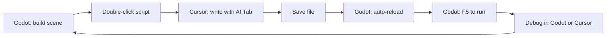
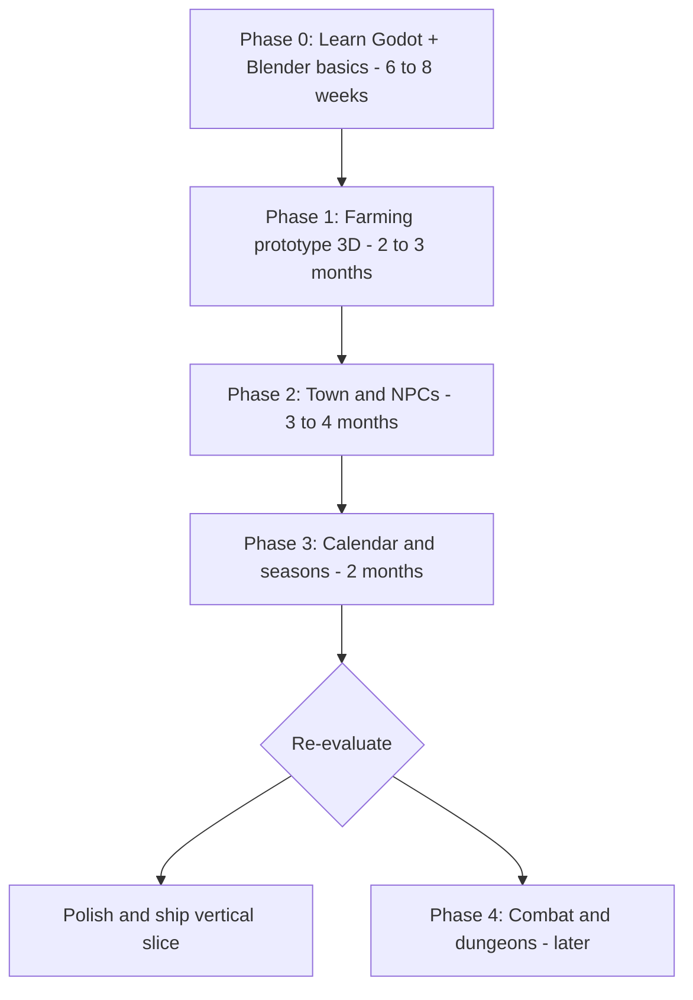
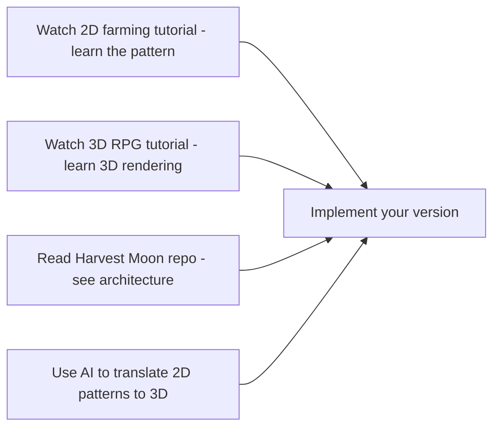

# Greenrune — Starter Roadmap (Chibi 3D edition)

*A Rune Factory-inspired farming and town life-sim. Working title: **Greenrune**. Repo folder: `runefactory-clone` (placeholder, may rename to `greenrune` later).*

## Visual target

Chibi low-poly 3D characters with toon/cel shading in a stylized 3D world, viewed from a fixed semi-top-down camera. Dialogue uses 2D anime-style portraits over the 3D world. **Target reference: RF4 / RF3 Special** — both render simple 3D worlds (flat ground, low-poly buildings, placed props) with chibi toon-shaded characters. The expensive-looking part of that aesthetic comes free from KayKit + Mixamo; the world is intentionally simple.

**Hard commitment: asset packs only.** No custom humanoid modeling, no custom building modeling, until Phase 4+ at earliest. KayKit Adventurers + KayKit Dungeon + Quaternius Ultimate Nature + Mixamo + a single toon shader is the entire art toolkit for Phases 0–3.

## Ground rules (read these first)

1. **You are learning Godot AND Blender AND building a game at the same time.** That's three skill curves at once. Multiply your time estimates by ~2x; this is normal for a first 3D hobby project.
2. **Combat, monsters, dungeons, marriage, magic — all deferred.** Not "skipped forever," just not now. The moment you let these creep in early, the project dies.
3. **Assets first, custom modeling later (if ever).** You will use **KayKit**, **Quaternius**, **Mixamo**, and **Kenney 3D** for the entire first year. Only model things in Blender that you can't find in a free pack. Even commercial indies do this.
4. **AI assists, you understand.** Never paste code you can't explain in plain English. AI is great at GDScript boilerplate, shaders, and state machines, but it will confidently invent Godot APIs that don't exist. Verify against the [Godot 4 docs](https://docs.godotengine.org/en/stable/).
5. **Done > perfect.** Every phase ends in a playable build you'd send to a friend, even if it's ugly.

## Engine & tooling decision

- **Engine: Godot 4 (latest stable)** — free, MIT license, 3D got dramatically better in v4, GDScript is Python-like and very AI-friendly.
- **3D modeling/animation: Blender (latest LTS)** — free, industry-standard. Used minimally; mostly for editing existing assets and small props.
- **Asset pipeline: GLTF/GLB** — the modern standard, fully supported by both Blender and Godot.
- **Auto-rigging/animation: [Mixamo](https://www.mixamo.com)** — free from Adobe. Upload a model, get walk/idle/attack/sit animations. Eliminates ~80% of beginner animation pain.
- **Language: GDScript** (not C#). Lower friction for a first game, more tutorials, AI handles it well. (You can switch to C# in Godot later if AI assistance on GDScript ever frustrates you — C# has more training data.)
- **Version control: Git from day one** with [Git LFS](https://git-lfs.com/) for `.blend`, `.glb`, and texture files (binary assets bloat normal Git fast).
- **Code editor: Cursor** (with `godot-tools` extension) writing all scripts, while Godot's built-in editor handles scenes, running, and debugging. See the [Cursor + Godot workflow](#cursor--godot-workflow) section below.

## Cursor + Godot workflow

You'll run **two apps side-by-side**: Godot for scenes/levels/running the game, Cursor for all GDScript with AI assistance. They share the same project folder and auto-sync via file watching.

### One-time setup (do this in Phase 0, week 1)

1. **In Cursor**: install the **`godot-tools`** extension from the marketplace. It provides:
   - GDScript syntax highlighting + autocomplete via Godot's built-in LSP
   - Go-to-definition, hover docs, find-references
   - Breakpoint debugging that connects to a running Godot game

2. **In Godot**: `Editor → Editor Settings → Text Editor → External`:
   - Check **Use External Editor**
   - **Exec Path** (macOS): `/Applications/Cursor.app/Contents/MacOS/Cursor`
   - **Exec Flags**: `{project} --goto {file}:{line}:{col}`
   - Now double-clicking any `.gd` in Godot opens Cursor at the right line.

3. **In Godot**: `Editor Settings → Network → Language Server`:
   - Confirm it's running on default port (6005). The `godot-tools` extension auto-connects.

4. **In the project root**: the `.cursorrules` file is already set up (see repo root). This is the single most important AI-quality investment you'll make.

5. **Open the project folder in Cursor** at the same time as Godot. Both watch the same files.

### Daily workflow



- **Use Cursor for**: writing/editing all `.gd` scripts, ask-AI debugging, multi-file refactors with Agent mode, generating shaders, design discussions.
- **Use Godot for**: scene tree, inspector tweaks, F5/F6 to run, visual debugger, profiler, animation editor, particle editor, GLTF import config.
- When Godot detects a script changed in Cursor, it auto-reloads. Occasionally you may need to click the Godot window to force a refresh.

### Cursor features worth knowing

- **Tab completion**: huge productivity win on GDScript boilerplate (state machines, signal connections, save/load serialization).
- **Chat with `@file` / `@folder`**: when asking Cursor to extend or refactor scripts, attach existing files so it has context. Critical past ~10 scripts.
- **Agent mode**: for cross-file refactors ("rename `PlayerHealth` to `CharacterStats` everywhere").
- **Inline edits (Cmd+K)**: fastest path for changing a single function.
- **`.cursorrules`**: keep updating it as the project grows — add notes about your code conventions, asset locations, and any patterns you've established.

### Known AI hallucination patterns in Godot (watch for these)

- AI writing **Godot 3 syntax** (older API) — always say "Godot 4.x" in prompts; the `.cursorrules` file helps.
- Inventing methods that sound plausible but don't exist (e.g. `get_node_or_null` is real, `get_child_by_name` is not).
- Confusing `_process` and `_physics_process` semantics — `_physics_process` for physics/movement, `_process` for everything else.
- Suggesting `KinematicBody` (Godot 3) instead of `CharacterBody2D/3D` (Godot 4).
- Wrong signal connection syntax (Godot 4 uses `signal_name.connect(callable)`, not the old `connect("signal_name", target, "method")`).

The fix: a strong `.cursorrules` file + always cross-checking unfamiliar APIs against [docs.godotengine.org](https://docs.godotengine.org/en/stable/). AI is a co-pilot, not autopilot, especially for newer engines like Godot 4.

## Art strategy — free pre-rigged 3D asset packs

**You are NOT modeling humans from scratch.** Beginner-rigged humanoids fail in ways that look amateur. Use these instead:

- **[KayKit](https://kaylousberg.com/game-assets)** — free chibi RPG character + dungeon packs, already rigged, GLB format. **This is your primary character source.**
- **[Quaternius](https://quaternius.com/)** — huge free low-poly library: nature, farm, animals, buildings, props. CC0 license.
- **[Mixamo](https://www.mixamo.com)** — free auto-rigging + thousands of animations. Combine with KayKit characters for walk/idle/attack/sit/etc.
- **[Kenney 3D](https://kenney.nl/assets?q=3d)** — same trusted Kenney quality, 3D variants. CC0.
- **[Synty POLYGON packs](https://syntystore.com/)** ($15–40, optional later) — production-grade. Used by many shipped indies if you want to invest later.

**Style cohesion rule:** Pick ONE primary character pack (KayKit) and ONE primary environment pack (Quaternius or KayKit Dungeon) and stick to them. Mixing chibi proportions with realistic proportions is the #1 visual sin and instantly looks amateur.

**Toon shader:** You'll need a cel-shading shader for the RF-style look. Options:

- Use a community shader from [Godot Shaders](https://godotshaders.com/) (search "toon" or "cel")
- Have AI help you write a simple one (GLSL/Godot Shader Language)
- Outline effect via inverted hull or post-processing shader

Budget ~1 weekend in Phase 0 to get a toon shader you're happy with running on a test sphere + character.

### Hybrid 2D/3D — Sprite3D for crops, props, and effects

**Look closely at RF4 and you'll notice many "3D" elements are actually 2D sprites billboarded in 3D space.** Crop growth stages, pickup pop-ups ("+1 Turnip"), sparkle particles, distant grass, some held tools at rest — all flat 2D sprites that always face the camera. This is a deliberate hybrid technique, not a limitation.

**Godot supports this natively with `Sprite3D`:**

- Loads a 2D image (PNG/JPG)
- Lives in 3D space, depth-sorted against 3D objects correctly
- Set `Billboard` property to `Enabled` and it always faces the camera
- ~100x cheaper than even a low-poly 3D mesh
- Reuses the same image asset for both the world view and the inventory icon

**When to use `Sprite3D` over a 3D model:**

| Use case | Sprite3D | 3D model |
|---|---|---|
| Inventory icons | Always (it's UI anyway) | — |
| Pickup pop-up effects ("+1") | Yes | Overkill |
| Crop growth stages | **Yes — recommended** | Optional |
| Small ground plants, flowers, mushrooms | Yes | Overkill |
| Particles (dust, sparkles, leaves) | Yes (or `GPUParticles3D` with sprite texture) | — |
| Trees | No | Yes (trees benefit from depth) |
| Buildings, fences, terrain props | No | Yes |
| Player + NPCs | No | Yes (animation matters) |
| Held tools (in active use) | Maybe | Maybe — both work |

**Why this matters for your timeline:** the original Phase 1 plan said "3 growth-stage 3D models per crop." Using `Sprite3D` for crops saves you significant Blender time and reduces the asset cohesion risk (your crops won't accidentally drift in style from the rest of the world if they're flat painted sprites).

**Style cohesion warning:** if you go hybrid, pick a consistent pixel-art or painted-sprite style and stick to it. Mixing photoreal sprite textures with toon-shaded 3D will look bad. Sprout Lands-style chunky pixel art reads well next to KayKit chibi 3D — they share visual "weight."

## Phased roadmap

Timelines below assume ~8 hrs/week **and** the asset-packs-only commitment from the Visual target section. Custom Blender modeling would add 30–50% to these numbers; the plan is designed to avoid that.



**Total to playable vertical slice: ~12–15 months** (asset-packs-only). If you start custom-modeling humanoids or buildings, expect 16–20+ months instead.

### Phase 0 — Learn Godot + Blender + Shaders (6–10 weeks, ~8 hrs/week)

Do tutorials end-to-end without skipping. Do NOT start the real project yet.

**Godot 3D fundamentals (~3–4 weeks):**

- Official Godot "Your First 3D Game" tutorial (~3 hours).
- A 3D action RPG tutorial series — see [Tutorials & resources](#tutorials--resources) section for current recommendations.
- **Exit criterion:** you can explain `Node3D`, `CharacterBody3D`, `MeshInstance3D`, GLTF import, raycasts, and the basics of a `NavigationAgent3D`.

**Blender basics (~2–3 weeks):**

- Blender Guru's "Donut Tutorial" (the universally recommended starter, ~4 hours of video).
- Then: "How to model a low-poly chair" or similar small prop.
- Export your prop as `.glb` and import it into Godot. **This export/import roundtrip is the most important thing to master in Phase 0.**
- **You do NOT need to learn rigging, weight painting, or character modeling yet.** Mixamo + KayKit cover that.

**Toon shader (~1 weekend):**

- Find a community cel/toon shader on Godot Shaders, drop it onto a test scene, get it looking how you want.
- Bonus: outline shader (inverted hull method is easiest).
- **Exit criterion:** A KayKit chibi character standing on a Quaternius grass patch, both rendered with your toon shader, with a basic outline. Save this scene; it becomes your visual baseline.

### Phase 1 prerequisites — Godot MCP setup (do at the START of Phase 1)

Before writing real game code in Phase 1, set up Godot's MCP server so Cursor's AI can directly read your scene tree, validate GDScript against your actual project, and run/inspect the game. **This was deliberately deferred from Phase 0** — during tutorials you want to learn manually; during real development you want AI to see your codebase.

**Recommended servers (pick one):**

- **[Coding-Solo/godot-mcp](https://github.com/coding-solo/godot-mcp)** — most popular (2,785+ stars), MIT, easiest setup. **Start here.**
- **[tugcantopaloglu/godot-mcp](https://github.com/tugcantopaloglu/godot-mcp)** — 149 tools, most feature-rich. Switch to this if you outgrow the first.
- **[lifeiscontent/godot-mcp](https://github.com/lifeiscontent/godot-mcp)** — native GDScript addon, no Node.js dependency. Good if you don't want extra runtimes.

**Setup for Coding-Solo's server (the simple path):**

Add to your Cursor MCP config (`~/.cursor/mcp.json` or via Cursor Settings → MCP):

```json
{
  "mcpServers": {
    "godot": {
      "command": "npx",
      "args": ["-y", "godot-mcp-server"]
    }
  }
}
```

Restart Cursor. The Godot MCP tools should appear in your available tools.

**What this gives you:**

- AI can read your scene tree and node properties
- AI can inspect/edit GDScript files with awareness of your project structure
- AI can trigger play/stop and read runtime errors
- AI can validate GDScript syntax against your project before save
- AI can query project settings, input maps, collision layers

**When NOT to use MCP:**

- During the Godot Docs and GDQuest tutorials — you want manual practice.
- For trivial single-script changes — Cursor Tab + the `godot-tools` LSP is enough.

**Risk to watch:** with MCP, AI can do too much for you. If you find yourself asking AI to "build the inventory scene for me" instead of "explain how I should structure the inventory scene," step back. MCP makes the lazy path easier — discipline yourself to use it for *augmentation*, not replacement.

### Phase 1 — Farming prototype, 3D (3–4 months)

Smallest possible playable loop. **One 3D farm scene, no town yet.**

- **Player character:** KayKit Adventurer chibi model + Mixamo walk/idle animations.
- **Camera:** fixed semi-top-down (~45° angle, follows player), similar to RF4. Implement as a `Camera3D` attached to a `SpringArm3D`.
- **Farm scene:** terrain (small flat MeshInstance or HeightMap), Quaternius/KayKit barn + fences + trees as props.
- **Tools:** hoe (till — modifies a tile state), watering can, seeds, harvest. Tile state is a 2D grid managed in code, but visuals are 3D.
- **Crops:** 2 types (e.g. turnip fast, potato slow), each with 3 growth stages. **Recommended: use `Sprite3D` billboards with painted/pixel-art textures** — see "Hybrid 2D/3D" above. This is much faster than modeling 3D crops and visually matches RF's actual approach. Alternative: Quaternius vegetation 3D meshes if you want pure 3D.
- **Inventory + hotbar:** 2D UI (`Control` nodes) overlaid on the 3D world. Start with 8 slots.
- **Day cycle:** sleep-to-next-day. Use a `DirectionalLight3D` rotating around to fake sun position. Skybox can be a simple gradient.
- **Save/load:** implement in week 2–3, NOT later. Refactoring saves into a finished project is hell. Save tile states, inventory, time, gold.
- **One shop NPC:** another KayKit model with Mixamo idle, talk to → "sell all" menu.

**Exit criterion:** play 5 in-game days, save, quit, reload, continue farming. It's ugly and minimal but the 3D loop works.

### Phase 2 — Town & NPCs (4–5 months)

Now add the social layer in 3D.

- **Town scene:** second 3D scene built from Quaternius/KayKit buildings. Seamless transition from farm (probably scene-switch with fade rather than streaming for simplicity).
- **3–5 NPCs:** each = a KayKit model with a different texture/color + Mixamo animations. Daily state-machine schedules (home → work → tavern → sleep).
- **Pathfinding:** Godot's `NavigationAgent3D` + baked navmesh on the town scene.
- **Dialogue:** [Dialogic 2](https://github.com/dialogic-godot/dialogic) plugin. Use 2D portrait art for dialogue boxes — for placeholder portraits, you can commission cheap art on Fiverr later, or use AI-generated placeholders (single static images are fine; AI is bad at animated frames but okay at single portraits).
- **Friendship/affection points** per NPC.
- **Gift system** with per-NPC likes/dislikes/hates.
- **Proper shop:** buy seeds, sell crops at different rates.

**Exit criterion:** max friendship with one NPC over ~14 in-game days through dialogue and gifts. Watching a chibi character walk a navmesh-pathed daily routine in your toon-shaded town is the moment this feels "real."

### Phase 3 — Calendar & seasons (~2–3 months)

- **4 seasons, 28 days each** (RF/SDV standard).
- Season-specific crops (some die out of season).
- **Visual season swap:** terrain texture, tree variants (Quaternius has seasonal tree variants), skybox tint. This is the moment your 3D investment really pays off — autumn looks tangibly different from spring, not just a palette swap.
- 1–2 simple festivals (e.g. a harvest contest, a fishing day).
- Weather (sunny / rainy — `GPUParticles3D` for rain, rain waters crops automatically).

**Exit criterion:** play through a full in-game year and the loop still feels good.

### Phase 3.5 — STOP and re-evaluate

After ~12–15 months you'll have a finished, playable cozy 3D farming-and-town game with a distinctive chibi toon-shaded look. **This is a real accomplishment for a first 3D game.** Now choose:

- **Path A (recommended for first project):** Polish, add 2–3 more NPCs, polish portraits, ship it on itch.io as your first finished game. Then start a second project with combat from day one knowing what you now know.
- **Path B:** Add combat, dungeons, monsters — Phase 4. Add another ~18–24 months (3D combat is harder than 2D combat). This is where most hobby RF clones die. Only choose this if Phases 0–3 felt sustainable.

## AI assistance — how to use it well

- **Good uses:** GDScript boilerplate (inventory data classes, save serialization, state machines), explaining unfamiliar Godot/Blender concepts, **writing toon shaders** (AI is genuinely useful here), code review, generating dialogue text and NPC personalities, debugging stack traces.
- **Decent uses:** generating **single static 2D portrait images** for NPCs as placeholders. Pick a consistent style prompt and reuse it.
- **Dangerous uses:** asking AI to architect whole systems before you understand them; trusting AI-generated Godot API names without checking docs; AI-generating **animated** sprite frames or 3D models (currently bad at consistency); AI claiming a Blender keyboard shortcut exists when it doesn't.
- **Workflow:** read a tutorial → try yourself → get stuck → ask AI → understand the fix → move on. Don't skip step 2.

## Risks to actively manage

- **The Blender rabbit hole** — every hour you spend in Blender that isn't strictly needed is an hour not spent on the game. If a free asset exists, use it. Custom modeling is a "nice to have" Phase 4+ activity.
- **Save system debt** — implement early, version your save format from v1.
- **Scope creep** — keep a `NOT_IN_SCOPE.md` next to your TODO. When you get a "wouldn't it be cool if…" thought, write it there, not into the code.
- **Asset cohesion drift** — if you ever spend a session looking for art instead of coding, stop and go back to your one chosen pack combo. Inconsistent styles instantly look amateur.
- **3D performance traps** — beginners often overload scenes with high-poly meshes and dynamic lights. Stay low-poly, bake lighting where possible, profile early.
- **Burnout** — 8 hrs/week sustained for 2 years beats 30 hrs/week for 3 months then quitting. Pace.
- **AI overreliance** — if you can't read your own code without AI explaining it, slow down.

## Tutorials & resources

A curated, prioritized stack. Don't go searching for "Godot tutorial" yourself — you'll waste hours filtering low-quality results. Use these.

### Godot 4 3D fundamentals (Phase 0, do in order)

1. **[Godot Docs: "Your First 3D Game"](https://docs.godotengine.org/en/stable/getting_started/first_3d_game/index.html)** — free, ~3 hours, official. The canonical starting point. Builds "Squash the Creeps." Do this first.
2. **[GDQuest – "Your First 3D Game From Zero: Survivor Arena FPS"](https://www.youtube.com/watch?v=NJJNWGD25rg)** — free, 2h23m, 2025. Modern and polished. Different mechanics than #1, good complement.
3. **[Coding Quests – "3D Action RPG Remastered in Godot 4.2"](https://www.youtube.com/watch?v=1m6UXCtw2Pg)** — free, **8 hours**. The most important tutorial for your project. Covers state machines, AnimationTree, monster AI, GridMap, damage systems, GUI. Spread across 3–4 weeks.
4. **Optional paid:** [GDQuest "Learn 3D Gamedev from Zero with Godot 4"](https://school.gdquest.com/products/learn_3d_gamedev_godot_4) — $84, 14 modules, structured curriculum.

### Blender for game devs (Phase 0)

1. **[Blender Guru – Beginner Donut Tutorial](https://www.youtube.com/playlist?list=PLjEaoINr3zgEPv5y--4MKpciLaoQYZB1Z)** — free, ~5 hours. Universal starter. Interface, modeling, shading, lighting basics.
2. **[Grant Abbitt – "Blender 5 for Beginners: Model Any LOW POLY ANIMAL"](https://www.youtube.com/watch?v=F_JK9eaYYTQ)** — free, 2025. Game-asset-focused low-poly modeling.
3. **[Blender → Godot 4 export workflow](https://www.youtube.com/watch?v=4blCo5BpgWM)** + **[GLTF settings tutorial](https://www.youtube.com/watch?v=_eIAl_HZWXM)** — free. Get the export/import roundtrip solid.
4. **Reference:** [Godot docs – Exporting 3D scenes](https://docs.godotengine.org/en/stable/tutorials/assets_pipeline/exporting_3d_scenes.html).

**Pipeline cheat sheet:** Export as `.glb` (binary), enable "Embed Images," set roughness/metallic to "non-color," texture interpolation "closest" for low-poly crispness.

### Toon shader (Phase 0)

1. **[Godot Shaders – "Complete Cel Shader for Godot 4"](https://godotshaders.com/shader/complete-cel-shader-for-godot-4/)** — drop-in shader, free. Fastest path.
2. **[Supermatrix Studio – "Godot 4 Anime Shader: Definitive Cel Shading & Outline Guide"](https://supermatrix.studio/blog/creating-a-stylized-3D-cel-shader-in-godot-4-from-scratch)** — free article. Understand *how* it works.
3. **Simplest fallback:** Godot 4's `StandardMaterial3D` → Shading → Diffuse Mode: **Toon**. Zero code, gets you ~70% there.

### Mixamo → Godot pipeline (Phase 0/1)

1. **[Antz – "From Mixamo to Godot: An Easier Approach"](https://antzgames.github.io/godot/demo/tutorial/Mixamo/)** — current recommended workflow for Godot 4.3+. Handles track merging and texture quirks. No Blender required.
2. **[KingTornado – Mixamo to Godot video](https://www.youtube.com/watch?v=CM_T8sRgZFI)** — visual companion.
3. **KayKit-specific reference:** [doctor-g/KayKitAnimationInGodot](https://github.com/doctor-g/KayKitAnimationInGodot) — sample repo with the inherited-scene + bone-attachment pattern.

### Farming mechanics (Phase 1)

**Heads-up:** most farming-sim tutorials in Godot 4 are 2D. The farming *logic* (tilling, watering, crop timers, inventory) is dimension-agnostic — watch the 2D patterns, then implement in 3D yourself.

1. **[Raku Nana – Stardew Valley Clone in Godot 4](https://www.youtube.com/playlist?list=PLflAYKtRJ7dwtqA0FsZadrQGal8lWp-MM)** — free, multi-part, 2D. Best source for farming-specific logic. State machines and tile-data design port directly.
2. **[Tampopo Interactive – Pixel Art Farming in Godot 4](https://www.youtube.com/watch?v=QhOYYoDX3r0)** — free, 2D. Sounds, weather, particles, rain.
3. **[Zenva – Make a Farming RPG in Godot 4 (2024)](https://academy.zenva.com/product/godot-farming-rpg/)** — paid, 1h17m, 2D, structured.

### Dialogue + NPCs (Phase 2)

1. **[Dialogic 2 Official Docs](https://docs.dialogic.pro/getting-started)** — requires Godot 4.4+. Start here.
2. **[Branno – "Create a Complete Dialogue System in Godot 4"](https://www.youtube.com/watch?v=Tmy1tzhDLl4)** — free, 38 min. End-to-end Dialogic 2 walkthrough.
3. **For NPC schedules/pathfinding** (no dedicated tutorial — use these refs):
   - [Godot docs: NavigationAgent3D + Navmesh](https://docs.godotengine.org/en/stable/tutorials/navigation/index.html)
   - Reuse the monster-AI state-machine pattern from the Coding Quests Action RPG.

### Reference codebases (read other people's code)

**No single tutorial covers a 3D RF-style game in Godot.** You will be stitching tutorials together. Reading existing project code is the next best thing to a complete tutorial:

- **[Kenny-Haworth/Harvest-Moon-2.0](https://github.com/Kenny-Haworth/Harvest-Moon-2.0)** — open-source Harvest Moon-inspired Godot game. 2D, but the architecture (farming, shops, time progression, weather, inventory, energy system) translates directly. **Read this code.**
- **[Chris' Tutorials – Gatherer's Exterior RPG Pack](https://chris-tutorials.itch.io/gatherers-exterior-pack/)** — resource gathering RPG tutorial project with full source.
- **GitHub search:** `language:GDScript farming` and `language:GDScript rpg` — many small but useful reference projects.

### The skill-stitching map (the real workflow)

Your actual workflow in Phase 1+ will look like this — you are NOT following one tutorial:



This is normal. Every indie game that ships is built this way. The plan is designed around this gap — Phase 0 teaches the building blocks, Phases 1–3 are about combining them.

### Suggested Phase 0 schedule (~8 weeks at 8 hrs/week)

```mermaid
gantt
    title Phase 0 schedule
    dateFormat X
    axisFormat W%w
    section Godot
    Your First 3D Game        :a1, 0, 1w
    Survivor Arena FPS        :a2, after a1, 1w
    Coding Quests Action RPG  :a3, after a2, 4w
    section Blender
    Donut Tutorial            :b1, after a1, 2w
    Low Poly Animal           :b2, after b1, 1w
    Blender to Godot pipeline :b3, after b2, 1w
    section Shader
    Toon baseline scene       :c1, after b3, 1w
    section Setup
    Cursor + Godot integration :d1, 0, 1w
    .cursorrules + Git LFS     :d2, 0, 1w
```



Don't try to finish in 4 weeks. The slow pace is what makes it stick.

## First week — concrete starting steps

1. Install **Godot 4 stable** and **Blender LTS**.
2. Set up the local repo — `.gitignore`, `.gitattributes` with **Git LFS** tracking, `.cursorrules`. (Already done in this repo's initial commit.)
3. **Cursor + Godot integration:**
   - Install **`godot-tools`** extension in Cursor.
   - In Godot, set Cursor as the external script editor (see [Cursor + Godot workflow](#cursor--godot-workflow)).
   - The `.cursorrules` file is already in place.
4. Download:
   - **KayKit Adventurers** pack (chibi rigged characters)
   - **KayKit Dungeon** pack (modular building props)
   - **Quaternius Ultimate Nature** pack (trees, grass, rocks)
   - Bookmark **Mixamo** — don't download yet, you'll grab animations as needed.
5. Do the official Godot **"Your First 3D Game"** tutorial end-to-end (~3 hours). Use the Cursor + Godot setup during this so the workflow becomes muscle memory.
6. Start **Blender Guru's "Donut Tutorial"** for Blender fundamentals.
7. Tick items off [PHASE_0_CHECKLIST.md](../PHASE_0_CHECKLIST.md) as you go.

That's it. No game code yet. No custom character models. No combat design. Just those seven things.
